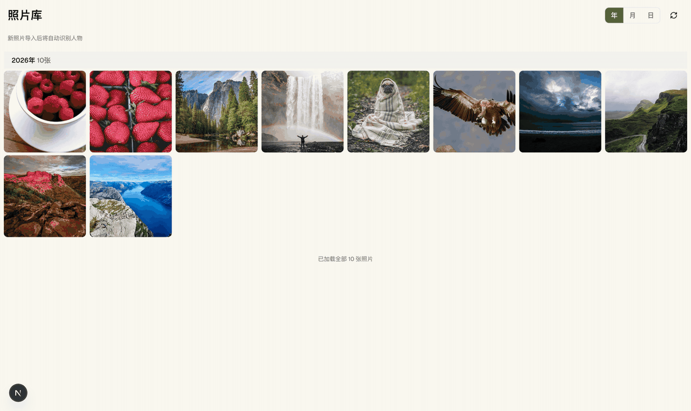
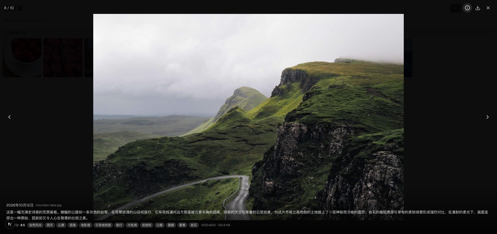
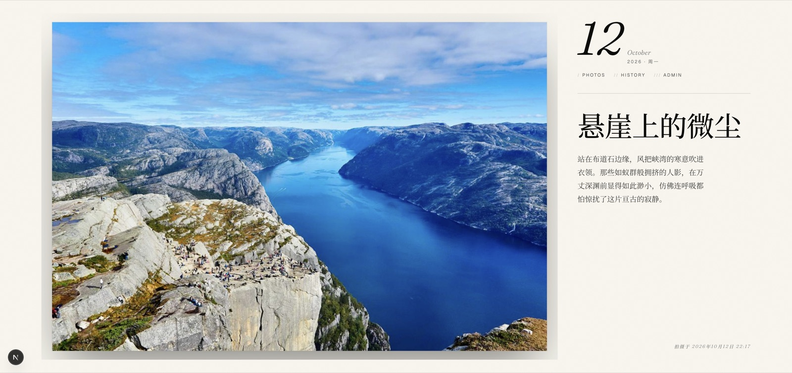

# 拾光 Relight

**照片 AI 分析与管理平台** — 扫描本地照片库，视觉模型在**本机**完成打标、写描述、评质量分，每天为你挑一张「每日精选」，配上一段它自己写的短文。

[](https://github.com/strzhao/relight/actions/workflows/ci.yml)
[](LICENSE)
[](https://github.com/strzhao/homebrew-relight)



## ✨ 它做什么

**导入即理解。** 照片进库后，本地视觉模型（OpenAI 兼容 API，默认指向你自己的 Qwen 视觉模型）自动完成三件事：

| | |
|---|---|
| **语义标签** | 中文美学体系：自然风光 / 电影感 / 引导线构图 / 冷色调……111 个标签来自 10 张样片 |
| **描述与评分** | 一段可读的中文描述 + 1-10 质量分，像一位住在相册里的图片编辑 |
| **每日精选** | 从库里挑一张，起一个文学标题（「悬崖上的微尘」），配一段短文，可推送到 macOS 菜单栏 App 自动换壁纸 |

<p>
  
  
</p>

**隐私不出门。** 视觉推理跑在本机（llama.cpp / Ollama 等任意 OpenAI 兼容端点均可），照片、标签、描述全程不离开你的电脑。

## English TL;DR

**Relight (拾光)** is a local-first AI photo library. Point it at a folder; a local vision model (any OpenAI-compatible endpoint, e.g. Qwen-VL via llama.cpp) tags every photo with Chinese aesthetic labels, writes a one-paragraph description with a quality score, and picks one "daily photo" with a generated title and short essay. Ships with a macOS menu-bar app that sets the daily pick as your wallpaper.

```bash
brew tap strzhao/relight
brew install --cask relight   # macOS app (Apple Silicon)
```

Self-hosting the web app: see 快速开始 below (Node ≥ 20, pnpm, Redis).

## 技术栈

| 层 | 技术 |
|---|------|
| Web 前端 | Next.js 15, React 19, Tailwind CSS 4 |
| 后端 API | Hono, Drizzle ORM, SQLite |
| 任务队列 | BullMQ + Redis |
| AI 服务 | OpenAI 兼容 API（Qwen 视觉模型，默认本地） |
| 工具链 | TypeScript, Biome, Vitest, Playwright, Turborepo, pnpm |

## 快速开始

### 桌面 App（macOS，最简单 · 仅 Apple Silicon）

```bash
brew tap strzhao/relight
brew install --cask relight
```

更新：`brew upgrade --cask relight`。也可前往 [Releases](https://github.com/strzhao/relight/releases) 手动下载 `Relight-vX.Y.Z.zip`（首次打开右键「打开」绕过 Gatekeeper）。

### 自托管 Web（完整功能）

环境要求：Node.js ≥ 20、pnpm ≥ 10、Redis（BullMQ 任务队列）。

```bash
pnpm install
cp .env.example .env   # 编辑 .env：数据库/照片目录/AI 端点
pnpm db:push           # 初始化数据库
pnpm dev
```

- Web: http://localhost:3001
- Backend: http://localhost:3000

## 项目结构

```
apps/web/          Next.js 前端应用
apps/backend/      后端 API + 任务队列
apps/mac/          macOS 菜单栏 App（每日精选自动壁纸）
packages/shared/   共享类型与 Zod Schema
```

## 发布流程（桌面 App）

向仓库推送 `vX.Y.Z` 形式的 tag 即触发 `.github/workflows/release.yml`：在 macOS runner 上 `xcodebuild archive`（Release，arm64，ad-hoc 签名）→ 打包 `Relight-vX.Y.Z.zip` → 创建 GitHub Release → 自动更新 `strzhao/homebrew-relight` tap 的 cask。

## 脚本

| 命令 | 说明 |
|------|------|
| `pnpm dev` | 启动所有开发服务 |
| `pnpm build` | 构建所有包 |
| `pnpm lint` | Biome 代码检查 |
| `pnpm format` | Biome 自动格式化 |
| `pnpm typecheck` | TypeScript 类型检查 |
| `pnpm test` | 运行单元/集成测试 |
| `pnpm test:e2e` | 运行 E2E 测试 |
| `pnpm db:push` | 推送 Drizzle schema |
| `pnpm db:studio` | 打开数据库浏览界面 |

## License

[MIT](LICENSE) © 2026 strzhao
